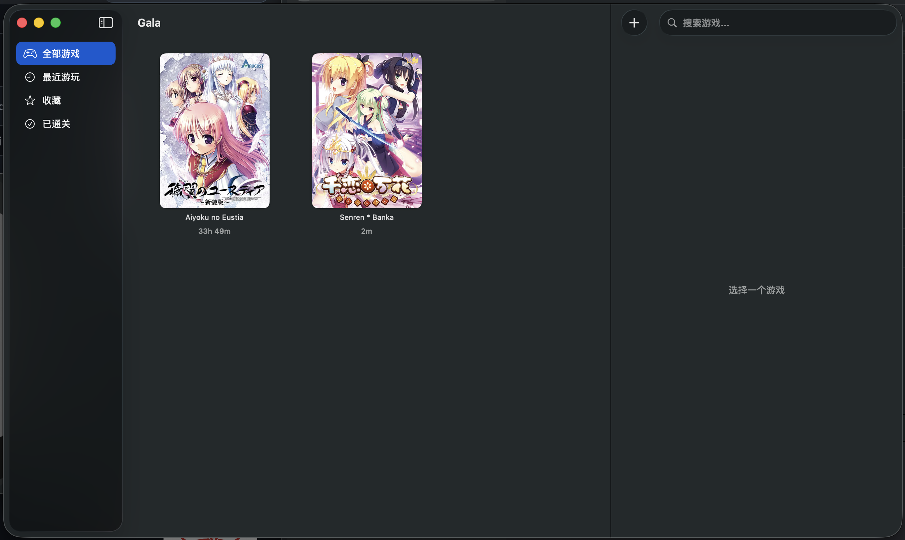

<p align="center">
  
</p>

<h1 align="center">Gala</h1>

<p align="center">
  macOS 上的 Galgame 启动器<br>
  添加游戏，配置环境，点击启动。Wine、字体、运行环境由 Gala 管理。
</p>

---

## 先说清楚它能做到什么

Gala 用 Wine 运行 Windows 视觉小说。日系引擎五花八门，同一套 Wine 配置不可能跑所有游戏，所以：

- **确定能跑的只有[已验证的游戏](docs/compatibility.md)**，都在 M1 Pro 上测过。
- **其他游戏可能直接能跑，也可能不能。** 不能跑时，多半是它需要的"运行环境"还没有人配出来。
- **运行环境是可以自己换、自己写的文件。** 2.0 起不需要等维护者适配：在游戏的"运行设置"里换环境、拨开关，或者自己写一个环境文件，试出来了再[分享给别人](#分享一个运行环境)。

这个项目起因是想在 Mac 上玩[穢翼のユースティア](https://vndb.org/v3770)，由一个人业余维护。维护者手里没有的游戏没法测，所以新游戏的支持主要靠用的人反馈和贡献。

## 功能

- **封面墙游戏库**：搜索、收藏、标记通关，把游戏文件夹拖进窗口就能添加
- **VNDB 信息**：封面、中文标题、开发商、发售日期、评分、通关时长、有没有官方中文或民间汉化
- **引擎识别**：按游戏目录里的文件特征判断引擎，选出默认的运行环境
- **运行环境**：Gala 下载并管理 Wine、字体和需要的 Windows 组件；同一种环境的游戏共用一个 Wine 前缀，不必每个游戏装一套
- **运行设置**：每个游戏可以单独换运行环境、切换视频播放方式和图形渲染，还可以填自定义的 DLL 设置、环境变量和启动参数
- **求助信息**：一键生成包含诊断信息和可调设置的文字，贴给任何 AI 助手或贴到 issue 里
- **应用内更新**：自动检查新版本，查看更新说明，下载并安装
- **游戏时间统计**：自动记录游玩时长
- **命令行工具** `gala-cli`：随应用分发，用来诊断和试验，也方便交给 AI 编程助手操作

## 截图




## 系统要求

- macOS 14 (Sonoma) 或更高版本
- Apple Silicon Mac (M1+)

## 安装

1. 下载 [Gala.dmg](https://github.com/NozomiX1/Gala/releases/latest)，打开后将 Gala 拖入 Applications
2. 前往访达 → 应用程序，双击 Gala 启动。Gala 没有 Apple 的开发者签名，首次打开需要在「系统设置 → 隐私与安全性」里点「仍要打开」
3. 首次启动会自动准备 Wine 运行时、CJK 字体和辅助工具，并显示当前下载项目与进度。下载量约 1.5 GB，部分依赖在海外，建议打开代理

之后的更新在应用内完成。从 1.x 升级需要手动下载一次 2.0 的 DMG 覆盖旧版；游戏库、游玩时间和已经配置好的环境都会保留。

## 使用

1. **添加游戏**：把游戏文件夹或 `.exe` 拖进窗口，或者点封面墙最后的虚线格子。然后在 VNDB 的搜索结果里选中这个游戏，也可以不匹配直接添加。
2. **配置环境**：点封面进入游戏页面，点「配置环境」。第一次配置某一种环境要下载和安装组件，需要几分钟；之后同一种环境的游戏会直接复用。
3. **启动**：按钮变成「启动」后点它。

其他操作：

- 游戏页面的 `···` 菜单里可以更改启动文件、移除运行环境、从库中移除。
- 「设置」（⌘,）的「运行环境」页检查并修复 Wine、字体和辅助工具；「数据」页清理 Wine 配置或全部本地数据。

## 游戏跑不起来怎么办

按顺序试：

1. **拨开关。** 游戏页面启动按钮旁边的滑块图标是「运行设置」。
   - 片头或过场动画黑屏、被跳过：换「视频播放方式」。
   - 有声音但画面全黑：把「图形渲染」换成 DXMT。
   - 开关改完直接启动就生效，不需要重新配置。
2. **换运行环境。** 同一个面板最上面一项。换完需要点一次「配置环境」。
3. **问 AI。** `···` 菜单里的「复制求助信息…」会生成一段文字，里面有诊断信息、所有能改的设置和回答格式。贴给任何 AI 助手，按它说的改一项、试一次。
4. **提 issue。** [新建 issue](https://github.com/NozomiX1/Gala/issues/new/choose) 并贴上同一段求助信息。没有诊断信息的 issue 基本没法处理。

不要修改游戏目录里的文件，也不要从别的网站下载 DLL 放进去。需要的 Windows 组件都应该通过运行环境来装。

已知问题：

- 穢翼のユースティア：字体无法修改；少数场景切换时音频加载会卡住数秒。
- アマカノ3：第一次启动时 OP 可能先有声音、画面稍后才出现，第二次启动后恢复同步。
- Wine 运行时有一定 CPU 占用，在被动散热机型（MacBook Air 等）上的表现未知。

## 自己写一个运行环境

运行环境是一个 JSON 文件。把它放进 `~/Library/Application Support/Gala/Profiles/`，它就会出现在运行设置的环境列表里，标着"我的"。

```json
{
  "id": "my-test",
  "name": "我的试验",
  "base": "common",
  "dllOverrides": { "quartz": "builtin" }
}
```

写了 `base` 就是继承那个环境的全部内容，这里只写不同的部分。可用的字段：

| 字段 | 含义 |
| --- | --- |
| `components` | 要安装的 Windows 组件，写 winetricks 里的名字 |
| `dllOverrides` | 某个 DLL 用 Windows 原版（`native`）还是 Wine 自带的（`builtin`）；值写 `null` 表示去掉继承来的那一条 |
| `registry`、`registryDelete` | 要写入或删除的注册表项 |
| `wine` | `default` 或 `dxmt`（用带 DXMT 的 Wine，由它渲染 D3D11） |
| `notes`、`verifiedGames` | 说明文字，和用它验证过的游戏 |

内置的环境在 [`GalaKit/Sources/GalaKit/Resources/Profiles/`](GalaKit/Sources/GalaKit/Resources/Profiles) 里，可以直接当例子看。写坏的文件会被跳过并在诊断信息里指出错在哪，不会影响其他游戏。

不想手写的话，先在运行设置里把开关和高级项试到能用，再点「把当前配置导出为文件…」。

喜欢命令行的话，应用里带了 `gala-cli`（`/Applications/Gala.app/Contents/MacOS/gala-cli`）。`gala-cli guide` 会输出完整的排查步骤，也可以把这份指南交给 Claude Code、Codex 这类工具，让它替你试。

### 分享一个运行环境

如果你试出了一个能让某款游戏正常运行的环境，欢迎提交：

1. 把文件放进 `GalaKit/Sources/GalaKit/Resources/Profiles/`，`id` 和文件名保持一致。
2. 在 `verifiedGames` 里写上你测过的游戏的原名。
3. 只对个别游戏有效的改动不要加进 `common`，另建一个 `"base": "common"` 的文件。
4. 运行 `swift test --package-path GalaKit`，再按测试的提示更新 `docs/compatibility.md`。
5. 提 Pull Request，说明测试的机器、游戏版本，以及片头、视频、文字显示是否正常。

不会用 Git 也没关系：新建一个 issue，把文件内容和测试情况贴上来。

## 构建

`Gala.xcodeproj` 由 [XcodeGen](https://github.com/yonaskolb/XcodeGen) 从 `project.yml` 生成，不在仓库里。

```bash
brew install xcodegen
xcodegen generate
open Gala.xcodeproj
# Xcode → Build & Run
```

## 依赖

Gala 会自动下载并管理这些运行时依赖：

| 依赖 | 版本 | 用途 | 许可证 |
|------|------|------|--------|
| [Wine Staging](https://github.com/Gcenx/macOS_Wine_builds) | 11.6 (Gcenx) | 运行 Windows exe | LGPL |
| [思源黑体](https://github.com/adobe-fonts/source-han-sans) | Regular | Wine CJK 字体渲染 | OFL 1.1 |
| [winetricks](https://github.com/Winetricks/winetricks) | 20260125 | 安装引擎需要的 Windows 组件 | LGPL |
| cabextract | deps-v1 | 提取 winetricks 需要的 Windows 组件 | GPL |
| [DXMT](https://github.com/3Shain/dxmt) | v0.80 builtin | Artemis/iarsys D3D11 到 Metal 图形层 | MIT |
| Gala MF Runtime | deps-v3 | `artemis-mf-d3d11` 的 GStreamer/FFmpeg 媒体运行时和 WMV 音频缓存工具 | LGPL/GPL 组件组合 |

Wine、字体、`winetricks`、`cabextract`、DXMT 和 Gala MF Runtime 由 Gala 从自己的 release 资产下载，避免用户本机缺少辅助工具或第三方仓库变动时配置失败。DXMT 只会在配置 `artemis-d3d11` / `artemis-mf-d3d11` profile 时下载，并缓存到 Gala 本地目录；Gala MF Runtime 只会在配置 `artemis-mf-d3d11` profile 时下载。普通 `common` / `kirikiri` / `leaf` profile 不会安装它们。部分旧式引擎的 OP/视频播放需要 DirectShow / LAV 组件，Gala 会在创建 bottle 时通过 winetricks 安装这些组件；这些第三方组件由 winetricks 按其上游规则下载，并缓存到 Gala 自己的目录：

```bash
~/Library/Application Support/Gala/Cache/winetricks
```

这个缓存可被不同 bottle 复用，清除所有 Gala 本地数据时会一起删除。如果下载失败，「设置」的「运行环境」页会显示缺失，并可一键重新下载。

## 工作原理

Gala 封装 Wine Staging 运行 Windows 视觉小说。Wine 游戏会按运行环境 profile 共享 Wine 前缀（bottle），避免每个游戏都复制一套完整环境。未识别或老式 DirectShow 视频链常见的引擎会落到 `common`，例如 BGI、旧式 Artemis、NScripter、YU-RIS、RealLive、Majiro、AdvHD、QLIE 和 Unknown。需要额外兼容策略的引擎会拆到独立 profile；例如 Leaf/AQUAPLUS 使用 `leaf`，家族计划使用 `do-kizunar`，现代 iarsys/D3D11 Artemis 按媒体链路分到 `artemis-d3d11` 或 `artemis-mf-d3d11` 并使用 DXMT，避免它们的 DLL/图形/视频配置影响 `common` 或彼此污染。每个 bottle 会根据默认中文环境配置 codepage 和字体映射：

- **中文游戏** — GBK (936)
- **日文游戏** — Shift-JIS (932)

每个 Wine bottle 都会安装 Source Han Sans SC Regular，并将常见 Windows CJK / 旧式 UI 字体映射到它，避免中文、日文菜单和系统对话框显示为方框。

添加游戏后，Gala 会先保存游戏库记录。用户需要在详情页点击「配置环境」来创建或复用对应 bottle；配置完成后按钮会变为「启动」。如果清理了 Wine 配置，相关游戏会回到「配置环境」状态。

Gala 更新时不会自动删除游戏库或 Wine bottle。资料库迁移写回前会创建备份；如果读取失败，Gala 会显示错误并避免把现有资料库覆盖成空库。

### 引擎分流规则

Gala 会先检查本地文件特征，例如 XP3、BGI 可执行文件、Leaf/WHITE ALBUM2 文件组、家族计划的 `KIZUNAR`/`kzn_sc` 文件组等。本地识别结果优先级最高，并会合并多个特征打分：单独 XP3 会进入 KiriKiri，但 `iarsys64.dll`、`.pfs`、E-mote DLL 和可执行文件里的 `D3D11CreateDevice` / `D3DCompile` 字符串会把现代 Artemis D3D11 游戏分到专用 profile，避免汉化补丁的 XP3 抢占判断。如果同目录可执行文件还包含 `MFCreateMediaSession`、`MFStartup`、`MF.dll` 或 `MFPlat.DLL` 等 Media Foundation 信号，则进入 `artemis-mf-d3d11`；否则进入 DirectShow 型的 `artemis-d3d11`。

如果本地特征不足，Gala 才会读取 VNDB release 的 `engine` 字段作为 fallback。这个 fallback 只采纳 Windows release，并忽略 patch release，避免主机平台移植版或补丁包把游戏分到错误 profile。

少数 VNDB 引擎名会被额外保护：`Ikura GDL` 只有在本地也检测到家族计划文件时才进入 `do-kizunar`；`AQUAPLUS Engine` 只有在本地也检测到 Leaf/WHITE ALBUM2 文件时才进入 `leaf`。VNDB 的 `Artemis Engine` 只作为旧式 Artemis fallback；`artemis-d3d11` / `artemis-mf-d3d11` 必须由本地 iarsys/D3D11 特征触发。这样可以避免一个宽泛的 VNDB 引擎标签把其他游戏错误地放进特殊 Wine 环境。

每个运行环境的具体内容以 [`GalaKit/Sources/GalaKit/Resources/Profiles/`](GalaKit/Sources/GalaKit/Resources/Profiles) 里的文件为准，各自验证过哪些游戏见[已验证的游戏](docs/compatibility.md)。

## 卸载与空间清理

macOS 不会在拖拽删除 `Gala.app` 时自动清理应用支持目录。Gala 下载的 Wine 运行时、bottle、字体和工具位于：

```bash
~/Library/Application Support/Gala
```

可以在 Gala「设置」的「数据」页清理 Wine 配置，或在卸载前清除所有 Gala 本地数据。如果已经卸载 Gala，也可以手动删除该目录来彻底释放空间。

清除所有 Gala 本地数据会移除游戏库、封面缓存、Wine 运行时、bottle、字体、辅助工具和 winetricks 缓存。清理完成后，Gala 会显示「重新安装运行环境」和「退出 Gala」两个入口，避免在目录刚被删除后自动触发新的安装流程。

## 架构

```
Gala/           SwiftUI 应用（Views, ViewModels）
GalaKit/        Swift Package — Wine 管理、引擎检测、VNDB 客户端
```

## 兼容性说明

Gala 自身的启动路径开销很小，主要成本来自 Wine 和游戏引擎本身。早期测试中，秽翼のユースティア（BGI）曾出现启动后长时间黑屏、OP 被跳过的问题；后续排查确认，原因是旧式 DirectShow / LAV 视频链路没有正确配置，而不是单纯的引擎初始化慢。

当前旧式视频预设会自动安装 `quartz`、`amstream`、`lavfilters`，覆盖 BGI、KiriKiri、SiglusEngine、旧式 Artemis、NScripter、YU-RIS、RealLive 等依赖旧式视频播放链路的引擎。`common` 会启用 LAV Audio 的 WMA / WMA Pro / WMA Lossless 开关，减少 OP 只有画面没有声音的情况。Leaf/AQUAPLUS 额外使用更严格的 DirectShow / LAV RGB 输出配置，以修复 WHITE ALBUM2 的 OP/视频播放问题。家族计划独立使用 `do-kizunar`，因为它需要 builtin `quartz` 和 D.O. 的安装路径注册表。

现代 Artemis/iarsys D3D11 游戏的黑屏问题不属于 OP/DirectShow 链路；Gala 会为这类游戏在 Wine Staging 11.6 上叠加 DXMT v0.80，其中 Hamidashi 这类 DirectShow/ASF `.dat` 视频会进入 `artemis-d3d11`，甜蜜女友3这类 Media Foundation/WMV 视频会进入 `artemis-mf-d3d11`，避免两类视频链路共用同一个 bottle。

`artemis-mf-d3d11` 额外使用 Gala MF Runtime。启动前，Gala 会在 `~/Library/Application Support/Gala/MediaOverlays/<game-id>` 生成 per-game overlay：非视频资源用符号链接指回原游戏目录，`movie/*.wmv` 保留 WMV3 视频流并只把 WMA/WMA Lossless 音频轨转换为 PCM。原始游戏文件不会被修改；缓存会在源视频文件或 runtime 版本变化后重建。

第一次启动 `artemis-mf-d3d11` 游戏时，Wine / GStreamer 可能会生成媒体插件缓存；甜蜜女友3 的 OP 曾出现声音先播放、画面短暂黑屏后才同步的情况。第二次启动后缓存已存在，音画会恢复同步。

### 排除的方案

**魔改 Wine（fork/recompile）**：编译一次 60-75 分钟，Wine Staging 补丁每两周需要 rebase，维护成本相当于全职工作。参考 Proton-GE（个人维护者）和 CrossOver（整个公司 + Valve 资助）。

**原生引擎移植**：
- krkrsdl2（KiriKiri）：无 XP3 解密、缺少商业插件，README 明确写「不支持商业游戏」
- openbgi（BGI）：仅能运行 1 个试玩版，仍需 DLL 注入真实 BGI.exe
- 所有主流引擎（Artemis、SiglusEngine）均闭源，无法移植

## 为什么不用 GPTK

[Game Porting Toolkit](https://developer.apple.com/game-porting-toolkit/) 的 Wine 基础是 7.7（来自 CrossOver 22.1.1），其 32on64 WoW64 翻译层对日系 VN 引擎有根本性问题：

| 引擎 | 现象 | 根因 |
|------|------|------|
| BGI | 进程运行但窗口永远不出现 | 32on64 层无法处理 BGI 的窗口创建 |
| KiriKiri | 启动时崩溃（virtual.c 断言失败） | 虚拟内存管理器无法处理 KiriKiri 的内存分配模式 |

所有 GPTK 版本（1.0–3.0）使用相同的 Wine 7.7 基础，D3DMetal 版本号的升级不影响 Wine 层。几乎所有商业日系 galgame 都是 32-bit PE32 可执行文件，因此 **Wine Staging 11.6（Gcenx 构建）是目前唯一可行的方案**。

## 日系 Galgame 引擎现状

| 引擎 | 市场份额 | 趋势 | 原生移植 |
|------|----------|------|----------|
| KiriKiri Z | ~30%（~6800 作品） | 稳定，最大 | krkrsdl2 存在但无法运行商业游戏 |
| BGI/Ethornell | ~10-15% | 衰退，无新作 | openbgi 不可用 |
| Artemis | ~5-10% | 快速增长，业界迁移目标 | 闭源，不可能 |
| SiglusEngine | ~3-5% | 稳定（VisualArts 专用） | 无重实现 |
| CatSystem2 | ~3-5% | 缩小 | FelineSystem2 早期阶段 |

值得关注：Artemis 引擎支持 Win/Switch/PS4/PS5/iOS/Android/WebAssembly，若未来推出 64-bit Windows exe，GPTK 路径将重新可行。

## 许可证

MIT
