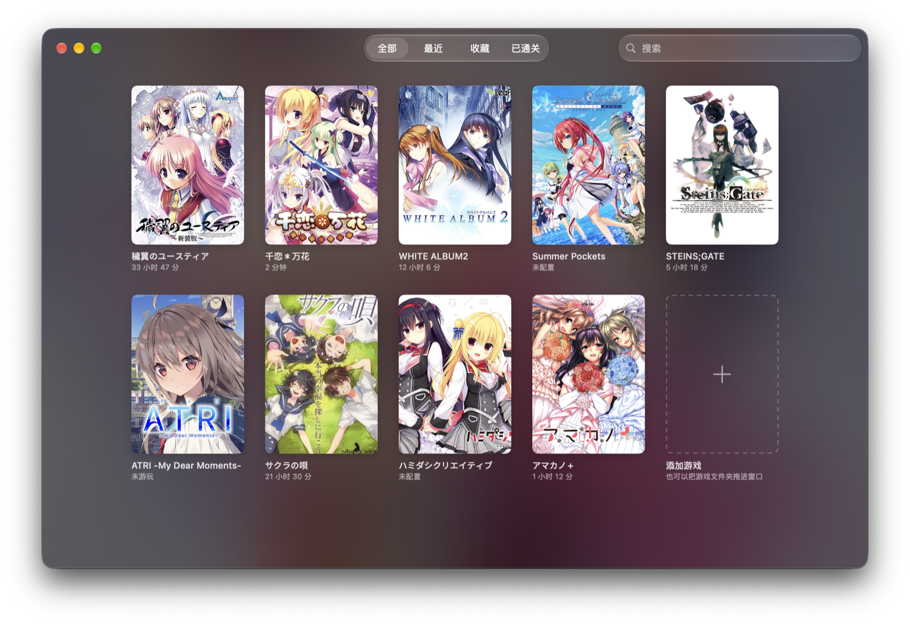
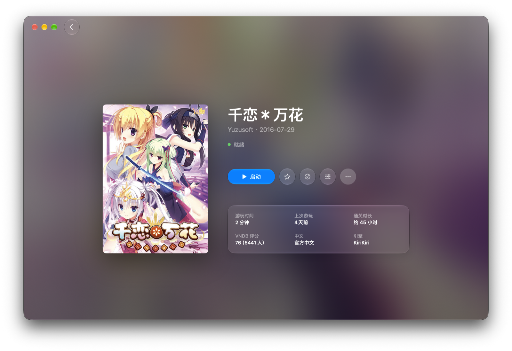
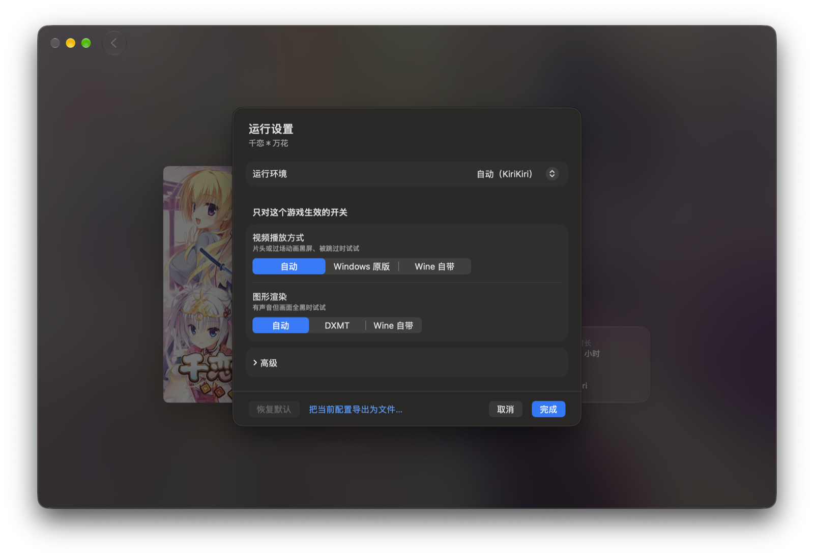
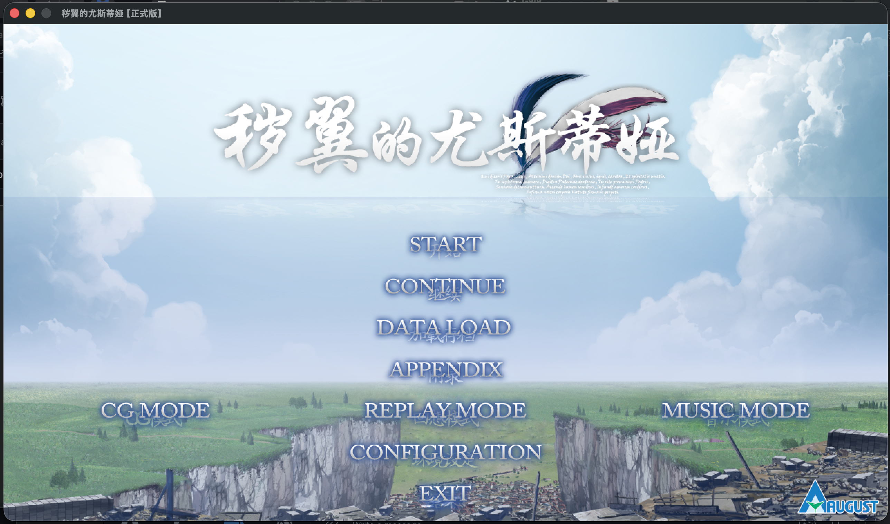

<p align="center">
  
</p>

<h1 align="center">Gala</h1>

<p align="center">
  macOS 上的 Galgame 启动器<br>
  添加游戏，配置环境，点击启动。Wine、字体、运行环境由 Gala 管理。
</p>

---

## 先说清楚它能做到什么

Gala 用 Wine 运行 Windows 视觉小说。日系引擎五花八门，同一套 Wine 配置不可能跑所有游戏，所以：

- **确定能跑的只有[已验证的游戏](docs/compatibility.md)**，都在 M1 Pro 上测过。
- **其他游戏可能直接能跑，也可能不能。** 不能跑时，多半是它需要的"运行环境"还没有人配出来。
- **运行环境是可以自己换、自己写的文件。** 2.0 起不需要等维护者适配：在游戏的"运行设置"里换环境、拨开关，或者自己写一个环境文件，试出来了再[分享给别人](#分享一个运行环境)。

这个项目起因是想在 Mac 上玩[穢翼のユースティア](https://vndb.org/v3770)，由一个人业余维护。维护者手里没有的游戏没法测，所以新游戏的支持主要靠用的人反馈和贡献。

## 功能

- **封面墙游戏库**：搜索、收藏、标记通关，把游戏文件夹拖进窗口就能添加
- **VNDB 信息**：封面、中文标题、开发商、发售日期、评分、通关时长、有没有官方中文或民间汉化
- **引擎识别**：按游戏目录里的文件特征判断引擎，选出默认的运行环境；运行过一次之后，再按游戏实际用到的组件给出建议
- **运行环境**：Gala 下载并管理 Wine、字体和需要的 Windows 组件；同一种环境的游戏共用一个 Wine 前缀，不必每个游戏装一套
- **运行设置**：每个游戏可以单独换运行环境、切换视频播放方式、图形渲染和文字区域（转区），还可以填自定义的 DLL 设置、环境变量和启动参数
- **求助信息**：一键生成包含诊断信息和可调设置的文字，贴给任何 AI 助手或贴到 issue 里
- **应用内更新**：自动检查新版本，查看更新说明，下载并安装
- **游戏时间统计**：自动记录游玩时长
- **命令行工具** `gala-cli`：随应用分发，用来诊断和试验，也方便交给 AI 编程助手操作

## 截图









## 系统要求

- macOS 14 (Sonoma) 或更高版本
- Apple Silicon Mac (M1+)

## 安装

1. 下载 [Gala.dmg](https://github.com/NozomiX1/Gala/releases/latest)，打开后将 Gala 拖入 Applications
2. 前往访达 → 应用程序，双击 Gala 启动。Gala 没有 Apple 的开发者签名，首次打开需要在「系统设置 → 隐私与安全性」里点「仍要打开」。如果点了之后没有反应或者密码框不出现，把 Gala 从应用程序里删掉、重新从 DMG 拖进去，然后在第一次打开之前在「终端」里运行 `xattr -dr com.apple.quarantine /Applications/Gala.app`；仍然打不开的话重启一次 Mac
3. 首次启动会自动准备 Wine 运行时、CJK 字体和辅助工具，并显示当前下载项目与进度。下载量约 1.5 GB，部分依赖在海外，建议打开代理

之后的更新在应用内完成。从 1.x 升级需要手动下载一次 2.0 的 DMG 覆盖旧版；游戏库、游玩时间和已经配置好的环境都会保留。

## 使用

1. **添加游戏**：把游戏文件夹或 `.exe` 拖进窗口，或者点封面墙最后的虚线格子。然后在 VNDB 的搜索结果里选中这个游戏，也可以不匹配直接添加。
2. **配置环境**：点封面进入游戏页面，点「配置环境」。第一次配置某一种环境要下载和安装组件，需要几分钟；之后同一种环境的游戏会直接复用。
3. **启动**：按钮变成「启动」后点它。

其他操作：

- 游戏页面的 `···` 菜单里可以更改启动文件、移除运行环境、从库中移除。
- 「设置」（⌘,）的「运行环境」页检查并修复 Wine、字体和辅助工具；「数据」页清理 Wine 配置或全部本地数据。

## 游戏跑不起来怎么办

按顺序试：

1. **看建议。** 游戏页面的状态旁边如果出现「查看建议」，先点开看。Gala 会记下游戏上次运行时实际用到的图形和视频组件，据此给出具体的建议；有些运行环境也带着作者写的提醒。
2. **拨开关。** 游戏页面启动按钮旁边的滑块图标是「运行设置」。
   - 片头或过场动画黑屏、被跳过：换「视频播放方式」。
   - 有声音但画面全黑：把「图形渲染」换成 DXMT。
   - 想玩日文原版（比如汉化版跑不起来，改用游戏自带的日文 exe）：把「文字区域」换成日文。它相当于转区，不会改变游戏本身的语言；玩中文版不用动它。
   - 开关改完直接启动就生效，不需要重新配置。
3. **换运行环境。** 同一个面板最上面一项。换完需要点一次「配置环境」。
4. **问 AI。** `···` 菜单（或者在封面上点右键）里的「复制求助信息…」会生成一段文字，里面有诊断信息、所有能改的设置和回答格式。贴给任何 AI 助手，按它说的改一项、试一次。
5. **提 issue。** [新建 issue](https://github.com/NozomiX1/Gala/issues/new/choose) 并贴上同一段求助信息。没有诊断信息的 issue 基本没法处理。

不要修改游戏目录里的文件，也不要从别的网站下载 DLL 放进去。需要的 Windows 组件都应该通过运行环境来装。

已知问题：

- 穢翼のユースティア：少数场景切换时音频加载会卡住数秒。
- アマカノ3：第一次启动时 OP 可能先有声音、画面稍后才出现，第二次启动后恢复同步。
- SiglusEngine 的游戏（Summer Pockets 等）：片头默认会被直接跳过，没有任何提示。游戏默认用 Windows Media Player 来放片头，这里放不出来。请在游戏的设置里把影片播放方式改成 MCI，之后片头就能正常播放。
- 带保护壳的汉化版 exe 可能一启动就闪退，例如 ノラと皇女と野良猫ハート 2016 年原版的汉化补丁。这类问题换运行环境解决不了，请换别的版本（这部作品的 Steam 版自带官方中文，可以运行）。
- 同一部作品的不同版本可能是完全不同的程序。[已验证的游戏](docs/compatibility.md)只对列出的那个版本有效。
- Wine 运行时有一定 CPU 占用，在被动散热机型（MacBook Air 等）上的表现未知。

## 自己写一个运行环境

运行环境是一个 JSON 文件。把它放进 `~/Library/Application Support/Gala/Profiles/`，它就会出现在运行设置的环境列表里，标着"我的"。

```json
{
  "id": "my-test",
  "name": "我的试验",
  "base": "common",
  "dllOverrides": { "quartz": "builtin" }
}
```

写了 `base` 就是继承那个环境的全部内容，这里只写不同的部分。字段分成两类。

**启动时带上的**，不会写进环境，改完直接启动就生效：

| 字段 | 含义 |
| --- | --- |
| `dllOverrides` | 某个 DLL 用 Windows 原版（`native`）还是 Wine 自带的（`builtin`）；值写 `null` 表示去掉继承来的那一条 |
| `wine` | `default` 或 `dxmt`（用带 DXMT 的 Wine，由它渲染 D3D11） |
| `environment` | 环境变量；值写 `null` 表示去掉继承来的那一个 |
| `launchArguments` | 给游戏程序的启动参数，例如 `["-windowed"]` |
| `locale` | 文字区域，例如 `ja_JP.UTF-8` |

**装进环境里的**：

| 字段 | 含义 |
| --- | --- |
| `components` | 要安装的 Windows 组件，写 winetricks 里的名字 |
| `registry`、`registryDelete` | 要写入或删除的注册表项 |

只写了第一类的文件不需要建新环境，直接用 `base` 的那个。写了第二类的，Gala 会把 `base` 的环境克隆一份，再把这里的组件和注册表加进去，通常只要十几秒，也几乎不多占空间。

其余字段：

| 字段 | 含义 |
| --- | --- |
| `notes`、`verifiedGames` | 说明文字，和用它验证过的游戏 |
| `advice` | 需要用户自己动手的一件事，比如"在游戏设置里改某一项"。会显示在游戏页面和运行设置里 |

内置的环境在 [`GalaKit/Sources/GalaKit/Resources/Profiles/`](GalaKit/Sources/GalaKit/Resources/Profiles) 里，可以直接当例子看。写坏的文件会被跳过并在诊断信息里指出错在哪，不会影响其他游戏。

不想手写的话，先在运行设置里把开关和高级项试到能用，再点「把当前配置导出为文件…」。

喜欢命令行的话，应用里带了 `gala-cli`（`/Applications/Gala.app/Contents/MacOS/gala-cli`）。`gala-cli guide` 会输出完整的排查步骤，也可以把这份指南交给 Claude Code、Codex 这类工具，让它替你试。

### 分享一个运行环境

如果你试出了一个能让某款游戏正常运行的环境，欢迎提交：

1. 把文件放进 `GalaKit/Sources/GalaKit/Resources/Profiles/`，`id` 和文件名保持一致。
2. 在 `verifiedGames` 里写上你测过的游戏的原名。
3. 只对个别游戏有效的改动不要加进 `common`，另建一个 `"base": "common"` 的文件。
4. 运行 `swift test --package-path GalaKit`，再按测试的提示更新 `docs/compatibility.md`。
5. 提 Pull Request，说明测试的机器、游戏版本，以及片头、视频、文字显示是否正常。

不会用 Git 也没关系：新建一个 issue，把文件内容和测试情况贴上来。

## 构建

`Gala/` 是 SwiftUI 应用，`GalaKit/` 是 Swift 包，放 Wine 管理、引擎识别、VNDB 客户端和 `gala-cli`。

`Gala.xcodeproj` 由 [XcodeGen](https://github.com/yonaskolb/XcodeGen) 从 `project.yml` 生成，不在仓库里。

```bash
brew install xcodegen
xcodegen generate
open Gala.xcodeproj
# Xcode → Build & Run
```

## 依赖

Gala 会自动下载并管理这些运行时依赖：

| 依赖 | 版本 | 用途 | 许可证 |
|------|------|------|--------|
| [Wine Staging](https://github.com/Gcenx/macOS_Wine_builds) | 11.6 (Gcenx) | 运行 Windows exe | LGPL |
| [思源黑体](https://github.com/adobe-fonts/source-han-sans) | Regular | Wine CJK 字体渲染 | OFL 1.1 |
| [winetricks](https://github.com/Winetricks/winetricks) | 20260125 | 安装引擎需要的 Windows 组件 | LGPL |
| cabextract | deps-v1 | 提取 winetricks 需要的 Windows 组件 | GPL |
| [DXMT](https://github.com/3Shain/dxmt) | v0.80 builtin | Artemis/iarsys D3D11 到 Metal 图形层 | MIT |
| Gala MF Runtime | deps-v3 | `artemis-mf-d3d11` 的 GStreamer/FFmpeg 媒体运行时和 WMV 音频缓存工具 | LGPL/GPL 组件组合 |

Wine、字体、`winetricks`、`cabextract`、DXMT 和 Gala MF Runtime 由 Gala 从自己的 release 资产下载，避免用户本机缺少辅助工具或第三方仓库变动时配置失败。DXMT 只会在配置 `artemis-d3d11` / `artemis-mf-d3d11` profile 时下载，并缓存到 Gala 本地目录；Gala MF Runtime 只会在配置 `artemis-mf-d3d11` profile 时下载。普通 `common` / `leaf` profile 不会安装它们。部分旧式引擎的 OP/视频播放需要 DirectShow / LAV 组件，Gala 会在创建 bottle 时通过 winetricks 安装这些组件；这些第三方组件由 winetricks 按其上游规则下载，并缓存到 Gala 自己的目录：

```bash
~/Library/Application Support/Gala/Cache/winetricks
```

另外，Gala 在创建运行环境时会请 macOS 下载两个苹果自带清单里的字体（简宋、华文黑体，约 50 MB），用于日本引擎游戏的宋体和黑体显示。它们由系统下载并存放在系统的字体目录里，Gala 不分发这两个字体；下载失败时改用系统已有的字体。「设置」的「运行环境」页里有一行「可选字体」，可以在那里重新下载，或者把它们应用到已经建好的运行环境（从 1.x 升级上来的环境需要点一次）。

这个缓存可被不同 bottle 复用，清除所有 Gala 本地数据时会一起删除。如果下载失败，「设置」的「运行环境」页会显示缺失，并可一键重新下载。

## 卸载与空间清理

macOS 不会在拖拽删除 `Gala.app` 时自动清理应用支持目录。Gala 下载的 Wine 运行时、bottle、字体和工具位于：

```bash
~/Library/Application Support/Gala
```

可以在 Gala「设置」的「数据」页清理 Wine 配置，或在卸载前清除所有 Gala 本地数据。如果已经卸载 Gala，也可以手动删除该目录来彻底释放空间。

清除所有 Gala 本地数据会移除游戏库、封面缓存、Wine 运行时、bottle、字体、辅助工具和 winetricks 缓存。清理完成后，Gala 会显示「重新安装运行环境」和「退出 Gala」两个入口，避免在目录刚被删除后自动触发新的安装流程。

## 许可证

MIT
